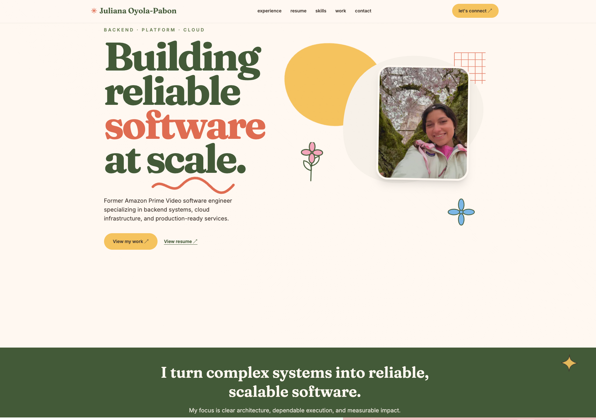
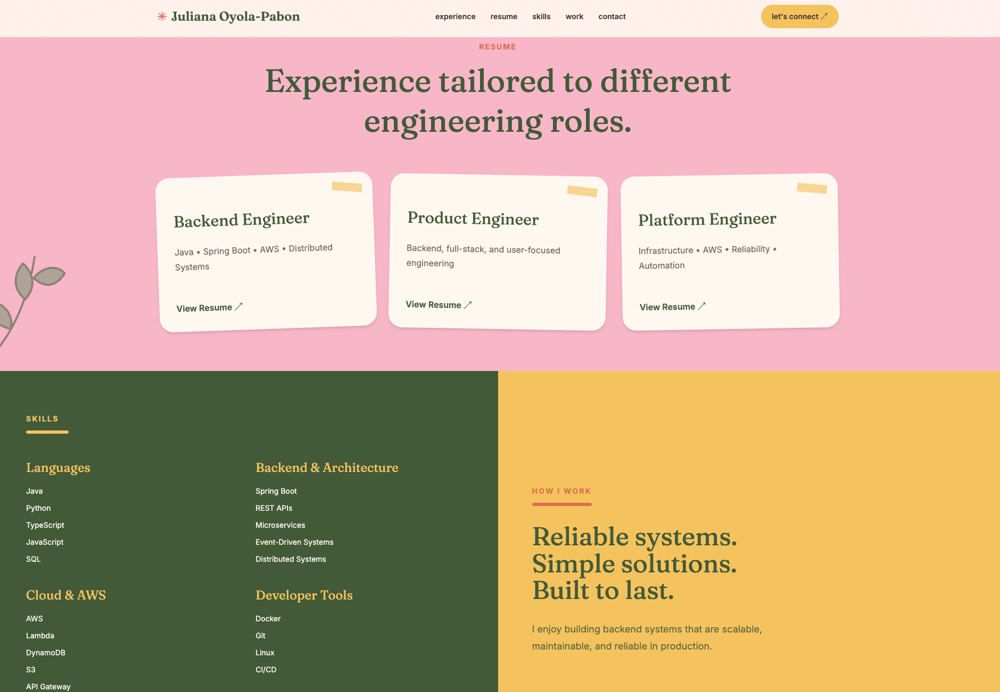

# Developer Portfolio



A responsive engineering and product design portfolio built with
Next.js, React, TypeScript, Tailwind CSS, and Framer Motion.
It includes selected projects, shared archive-style case studies,
interactive demos, a skills grid, an experience timeline, and
three role-specific resume PDFs.

Live site: https://juliana-portfolio-two.vercel.app

## Download and run

Use Node.js 20.9 or newer and npm. Clone the repository, or download
and extract its ZIP from GitHub before opening a terminal there.

```sh
git clone https://github.com/julsoyola/juliana-portfolio.git
cd juliana-portfolio/portfolio
npm ci
npm run dev
```

Open http://localhost:3000. Stop the server with Control-C.
No environment variables or external accounts are required for the
portfolio's simulated demos. They do not access real files or Drive.

## Project structure

```text
portfolio/
  app/                         Pages, metadata, and global styles
  components/
    home/                      Homepage sections and illustrations
    case-study-archive/        Shared archive layout and navigation
    motion/                    Accessible animation wrappers
    demos/figmacleaner/         Interactive canvas demo and model
  content/
    projects/                  Project cards, archive data, evidence
    skills.ts                  Skill groups
    experience.ts              Experience entries
    resumes.ts                 Published PDF cards
  public/                      Images, PDFs, and static Drive demo
  tests/                       Canvas and Drive demo behavior tests
resumes/                       Three LaTeX sources and shared style
scripts/                       Resume build and cleanup script
docs/                          Portfolio preview images
```

## Content and development flow

Edit project content in `portfolio/content/projects/<project>.ts`.
Each file owns the homepage card and archive configuration; supported
reflection evidence stays with its project. The ordered `cards.ts`
registry controls the homepage. Illustrations use stable project IDs.
Cards appear in pairs; collections over four cards enable scrolling.

Use the shared archive renderer for layout changes across case studies.
Keep project-specific engineering notes in their existing components.
Route files in `app/work/` supply metadata and compose those pieces.
The GoogleCleaner demo remains a static, isolated iframe; its source
and adaptation notes are in `public/demos/googlecleaner/README.md`.

For a new project, create its content file, add its card to the registry,
add a route, and supply real screenshots or explicit placeholders.
Keep public asset paths stable. Preserve reduced-motion behavior.

Run these checks from `portfolio/` before committing:

```sh
npm run lint
npm run typecheck
npm test
npm run build
```

After a successful build, `npm start` serves the production site.
Use npm and the committed `package-lock.json` for dependencies.
See [COMMANDS.md](COMMANDS.md) for individual build commands.

## Resume PDFs and LaTeX

The site publishes only Backend, Platform, and Product resumes.
Their PDFs are already included; LaTeX is optional for running the site.
Sources live in `resumes/` and share `resume.sty`. Do not remove that
style file. Avoid committing auxiliary LaTeX output.

> **LaTeX setup**
> - macOS: install MacTeX and make `pdflatex` available in PATH.
> - Linux: install TeX Live with recommended LaTeX and font packages.
> - Windows: use WSL with TeX Live and run commands inside WSL.
>   The build script requires Bash; native PowerShell is unsupported.
> - Verify the chosen environment with `pdflatex --version`.

From `portfolio/`, generate all three published PDFs:

```sh
npm run build:resumes
```

Or build one source:

```sh
npm run build:resume -- resumes/JulianaOBackend.tex
```

The script resolves source paths from the repository root, runs two
LaTeX passes, and copies PDFs to `portfolio/public/resumes/`.
Temporary files are removed automatically. `npm run clean:latex`
removes leftover build artifacts while keeping sources and PDFs.

## Deployment

Set the Vercel project's Root Directory to `portfolio` and use npm.
The connected deployment follows pushes to `main`.
Rebuild changed resume PDFs before committing their source changes.

## Preview



## Contact

- Portfolio: https://juliana-portfolio-two.vercel.app
- LinkedIn: https://linkedin.com/in/julianaoyola
- GitHub: https://github.com/julsoyola
- Email: Julianaaoyola@gmail.com
