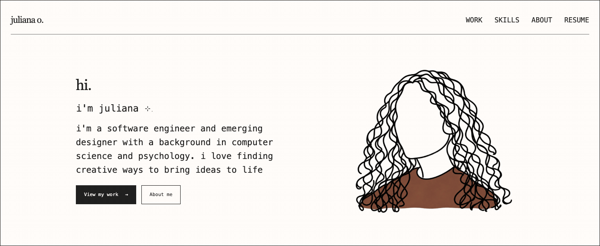
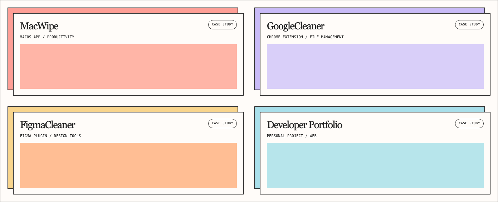
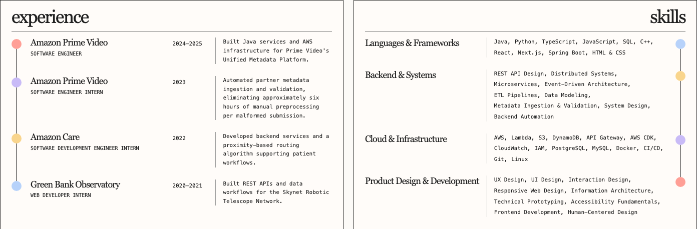
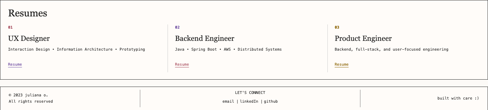

# Developer Portfolio



A software engineering and product design portfolio with project
case studies, interactive demos, experience, skills, and resumes.
Built with Next.js, React, TypeScript, Tailwind CSS, and Framer Motion.

[Visit the portfolio](https://juliana-portfolio-two.vercel.app)

<details>
<summary>Homepage screenshots</summary>

### Selected work



### Experience and skills



### Resumes and contact



</details>

## Download and run

Requires Node.js 20.9+ and npm.

```sh
git clone https://github.com/julsoyola/juliana-portfolio.git
cd juliana-portfolio/portfolio
npm ci
npm run dev
```

Or download the repository ZIP, extract it, and run the last two
commands inside its `portfolio/` folder.

Open http://localhost:3000. Stop with Control-C.
No environment variables or external accounts are required.
The demos use sample data and do not change real files.

## Commands

Run from `portfolio/`.

| Task | Command |
| --- | --- |
| Development server | `npm run dev` |
| Lint | `npm run lint` |
| TypeScript check | `npm run typecheck` |
| Tests | `npm test` |
| Production build | `npm run build` |
| Serve the production build | `npm start` |

Before committing, run lint, TypeScript checks, tests, and the build.
Use npm with the committed `package-lock.json`.

## Project structure

```text
portfolio/
  app/                       Routes, metadata, and global styles
  components/home/           Homepage layout and interactions
  components/case-study-archive/  Shared case-study template
  components/demos/           FigmaCleaner controls and sample canvas
  content/                   Projects, skills, experience, resumes
  public/                    Images, PDFs, and GoogleCleaner demo
  tests/                     Demo behavior tests
resumes/                     LaTeX sources and shared resume.sty
scripts/                     Resume build script
docs/screenshots/             README previews
```

## Editing content

| Update | Location inside `portfolio/` |
| --- | --- |
| Project cards and case-study content | `content/projects/<project>.ts` |
| Project order | `content/projects/cards.ts` |
| Skills and experience | `content/skills.ts`, `content/experience.ts` |
| Resume cards and PDFs | `content/resumes.ts`, `public/resumes/` |
| Homepage layout | `components/home/EditorialHome.tsx` and its CSS module |
| Shared case-study layout | `components/case-study-archive/` |
| Case-study routes and custom content | `app/work/<project>/page.tsx` |

To add a project: create its content file, register its card, add a
route using the shared template, and add screenshots to `public/images/`.
Keep asset paths stable and preserve reduced-motion behavior.

GoogleCleaner demo notes:
[public/demos/googlecleaner/README.md](portfolio/public/demos/googlecleaner/README.md).

## Resume PDFs

UX Designer, Backend Engineer, and Product Engineer PDFs are included.
LaTeX is only needed to rebuild them.

<details>
<summary>LaTeX setup and commands</summary>

| Platform | Setup |
| --- | --- |
| macOS | MacTeX with `pdflatex` on PATH |
| Linux | TeX Live with recommended LaTeX and font packages |
| Windows | WSL with TeX Live; run commands inside WSL |

The script requires Bash and `pdflatex`. From `portfolio/`:

```sh
pdflatex --version
npm run build:resumes
```

Build one resume:

```sh
npm run build:resume -- resumes/JulianaOBackend.tex
```

Source paths resolve from the repository root. The script runs two
LaTeX passes, copies PDFs to `portfolio/public/resumes/`, and removes
temporary files. Keep `resumes/resume.sty`.

Remove leftover LaTeX artifacts:

```sh
npm run clean:latex
```

Rebuild PDFs when their sources change. More commands:
[COMMANDS.md](COMMANDS.md).

</details>

## Deployment

Use `portfolio` as the Vercel Root Directory and npm for builds.
The connected deployment follows pushes to `main`.
